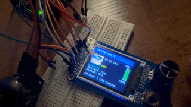
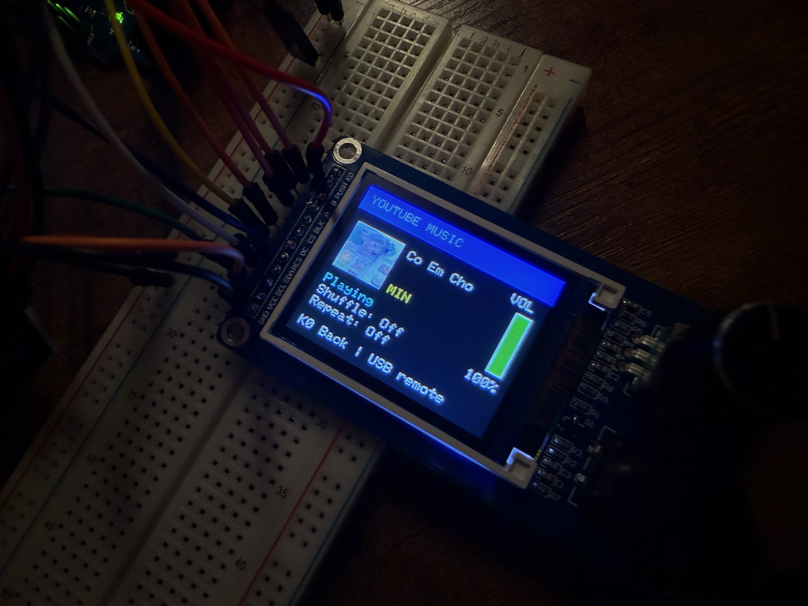
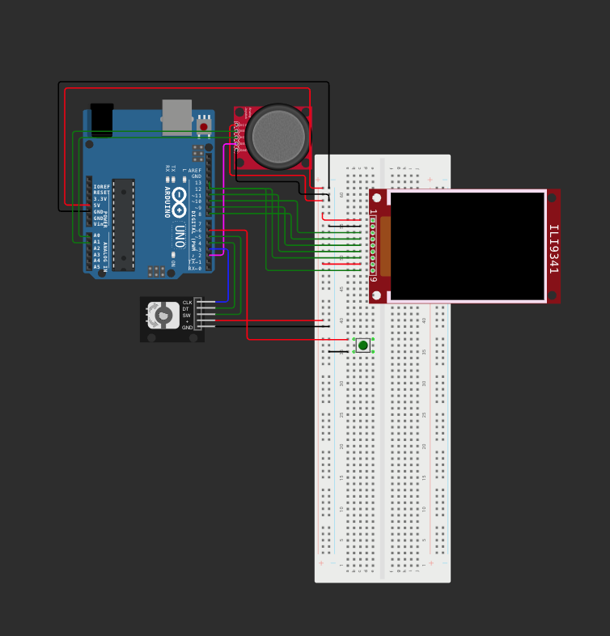

# Arduino TFT Arcade and YouTube Music Remote

An Arduino Uno R3 arcade with **Snake**, **Space Shooter**, and **Brick Breaker**, plus a **YouTube Music remote**. The 1.8-inch ST7735S TFT shows the current song, artist, cover thumbnail, play/pause status, shuffle and repeat modes, and a vertical volume meter. The Uno sends commands over USB while Google Chrome on the Mac plays the audio.

## Demo



[Download the full 56-second demo (MP4)](https://raw.githubusercontent.com/KhanhDo1609/Music_controller-combined_with_games_TFT-/main/media/now-playing-demo.mp4)

## Hardware and wiring



- Arduino Uno R3 and a USB data cable
- 1.8-inch ST7735S SPI TFT module with an EC11 rotary encoder and K0 button
- Analog joystick, breadboard, and jumper wires
- Five channels of 5 V-to-3.3 V level shifting for the TFT signals
- Optional passive piezo buzzer for game sounds

| Module | Pin | Uno connection |
| --- | --- | --- |
| TFT | GND | GND |
| TFT | VCC | Regulated 3.3 V |
| TFT | SCL | D13 (SPI clock) through level shifter |
| TFT | SDA | D11 (SPI MOSI) through level shifter |
| TFT | RES | D8 through level shifter |
| TFT | DC | D9 through level shifter |
| TFT | CS | D10 through level shifter |
| TFT | BLK | Leave open on the default-on module |
| Built-in encoder | A, B, PUSH | D3, D4, D5 |
| Built-in button | K0 | D6 |
| Joystick | GND, 5V | GND, 5V |
| Joystick | VRX, VRY, SW | A0, A1, D2 |
| Optional piezo | +, − | D7, GND |

Share ground between the Uno, display, and level shifter. The Uno's 3.3 V output is rated for 50 mA total. Use a separate regulated 3.3 V supply with common ground if the load exceeds that limit. The sketch expects pull-ups on the TFT module's encoder and buttons. Add a 10 kΩ pull-up to 3.3 V on any control input that floats. [Arduino Uno pinout](https://content.arduino.cc/assets/A000066-full-pinout.pdf)

### Simulator reference



[Open Wokwi](https://wokwi.com/projects/new/arduino-uno) · [Get the ILI9341 circuit and arcade sketch](https://github.com/KhanhDo1609/Game_TFT_Screen/tree/main/wokwi)

The diagram shows the earlier ILI9341 arcade simulator with separate controls. Use the table above for the physical ST7735S module and the Mac USB remote.

## Upload and run

1. In Arduino IDE's Library Manager, install **Adafruit ST7735 and ST7789 Library** and its dependencies.
2. Open [Music_controller_combined_with_games_TFT.ino](Music_controller_combined_with_games_TFT/Music_controller_combined_with_games_TFT.ino). Choose **Arduino Uno** and the USB port, then click **Upload**. All three games and the music controller are in this sketch.
3. In Google Chrome on macOS, open [YouTube Music](https://music.youtube.com/) and start a song or playlist. Enable **View → Developer → Allow JavaScript from Apple Events**. [Chrome setup](https://www.chromium.org/developers/applescript/)
4. Close Arduino IDE's **Serial Monitor**. From the repository root, run this in Terminal:

   ```sh
   python3 mac/music_remote.py
   ```

   If the helper can't find the Uno automatically, pass the port shown in **Tools → Port**, for example `python3 mac/music_remote.py /dev/cu.usbmodem11301`. If macOS prompts, allow Terminal to control Chrome.
5. When Terminal says **Listening**, select **YouTube Music** on the TFT. Keep Terminal running. If you restart the helper while the music screen is open, press **K0** and enter YouTube Music again.

The Mac helper uses Python 3, macOS scripting, and the existing Chrome session. Keep [`music_remote.py`](mac/music_remote.py) and [`chrome_bridge.js`](mac/chrome_bridge.js) together. The title and volume may appear before the artwork finishes transferring.

## Controls

| Screen | Controls |
| --- | --- |
| Arcade menu | Turn the encoder or move the joystick up/down. Press either to select. |
| Snake | Steer with the joystick. |
| Space Shooter | Move left/right with the joystick and press it to fire. |
| Brick Breaker | Move the paddle left/right with the joystick. |
| YouTube Music | Left/right skips tracks. Up shuffles, down cycles repeat, and pressing the joystick toggles play/pause. Turn the knob to change volume in 5-point steps. Press the knob to mute or unmute. |
| Any mode | Press K0 to return to the menu. |

Flappy Bird and Racing are menu placeholders. The combined sketch was compiled for the Uno using **22,726 bytes of program storage (70%)** and **992 bytes of global SRAM (48%)**.
